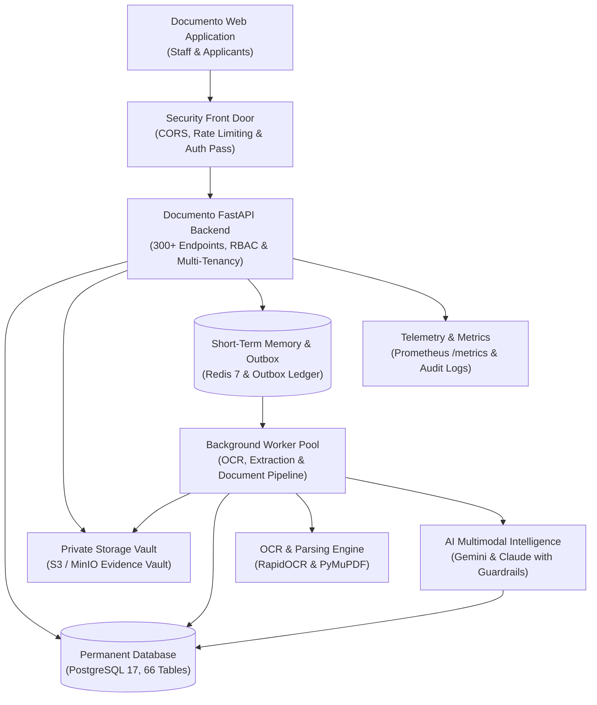

# Master Prompt: Production-Grade Module-by-Module Report (.md output)

## How to use

1. Open the project repository in an AI coding tool that can read the whole codebase (Antigravity, Claude Code, Cursor, Codex, Windsurf, etc.).
2. This prompt has been pre-configured specifically for **The Documento** backend platform (`backend/app`, `backend/workers`, `backend/alembic`, and `backend/tests`).
3. Paste everything between **PROMPT START** and **PROMPT END** as one message to execute the audit.
4. The AI writes `production_grade_report.md` in the project root. That file can be imported directly into Notion (or any Markdown viewer) and exported to PDF.

---

## PROMPT START

You are a senior software architect and technical auditor. Carry out a **complete, forensic review of this project's backend source code** and write a **plain-language, module-by-module production-readiness report** for non-technical stakeholders and leadership. Save it as a single Markdown file: **`production_grade_report.md`** in the project root.

### Project details

- **Product name:** The Documento (AI Immigration SaaS Platform)
- **Part of the system reviewed:** Backend Core API, Asynchronous Workers & AI Pipelines (`backend/app`, `backend/workers`, `backend/alembic`)
- **Subject line:** The Documento Webapp API (the "backend": the multi-tenant server-side intelligence engine powering The Documento platform)
- **Audience:** Documento Executive Leadership, Legal Compliance Officers, Technical Stakeholders, and Engineering Leads
- **Prepared:** October 2026

---

## STEP 1 — Review the code (do this before writing)

1. Read the entire backend codebase:
   - Entry points & middleware: `backend/app/main.py`, `backend/app/core/middleware.py`, `backend/app/core/logging.py`, `backend/app/core/errors.py`
   - Routers & controllers: all 24 API router files under `backend/app/api/v1/*.py` (300+ endpoints)
   - Domain models & database schema: `backend/app/domain/models.py` (66 database tables), `backend/app/db/`
   - Database migrations: all migration scripts under `backend/alembic/versions/*.py`
   - Subsystem services: `backend/app/documents/`, `backend/app/ocr/`, `backend/app/extraction/`, `backend/app/ai/`, `backend/app/rules/`, `backend/app/forms/`, `backend/app/packages/`, `backend/app/billing/`, `backend/app/analytics/`, `backend/app/audit/`, `backend/app/operations/`
   - Background workers & task queues: `backend/workers/runner.py`, `backend/workers/tasks/document_tasks.py`
   - Configuration & container infrastructure: `backend/app/core/config.py`, `backend/Dockerfile`, `docker-compose.yml`, `docker-compose.prod.yml`
   - Automated test suite: `backend/tests/` (49 test files verifying security, AI quality, RBAC, tenant isolation, disaster recovery, and release gates)

2. Evaluate the system strictly across these **18 business-level modules**:
   1. **Authentication, Accounts & Access Control (Auth & RBAC):** Login, session lifecycle, password reset, staff invitations, and role-based permissions (`auth.py`, `roles.py`, `models.User`, `models.Role`, `models.Session`).
   2. **Multi-Tenant Firm Workspace & Branch Management:** Organization boundaries, multi-branch operations, department teams, and staff membership management (`organizations.py`, `models.Organization`, `models.Branch`, `models.Team`).
   3. **Client Profiles, Applicants, Family Units & Consent Records:** Retained applicant records, dependant linkages, financial sponsors, and consent logs (`clients.py`, `models.ClientProfile`, `models.ClientDependant`, `models.FinancialSponsor`, `models.ClientConsent`).
   4. **Immigration Cases & Multi-Stage Lifecycle Engine:** Case creation, 7-stage lifecycle, milestones, internal staff notes, tasks, holds, and withdrawal tracking (`cases.py`, `domain/case_service.py`, `models.ImmigrationCase`, `models.CaseMilestone`).
   5. **Document Intake, Storage Vault & Evidence Custody:** Batch uploads, pre-signed URLs, immutable original evidence, file security scans, inactivity purging, and S3/MinIO storage (`documents.py`, `documents/storage.py`, `documents/upload_service.py`, `models.Document`).
   6. **Document OCR, Classification & Structured Data Extraction:** Optical character recognition (RapidOCR / ONNX), document type classification, MRZ passport parsing, financial table parsing, and human-in-the-loop field verification (`extractor.py`, `ocr/`, `extraction/`, `models.DocumentExtractedField`).
   7. **Transactional Outbox & Background Processing Workers:** Asynchronous event outbox, resilient document processing worker loop, retry counts, and dead-letter queue (DLQ) safeguards (`workers/runner.py`, `workers/tasks/`, `models.OutboxEvent`, `models.DocumentProcessingRun`).
   8. **AI Evidence Intelligence, Discrepancy Detection & Quality Audits:** Cross-document comparison, document quality scoring, prompt injection defense, PII masking, token tracking, and discrepancy lifecycle (`findings.py`, `ai.py`, `ai/`, `models.CaseAIFinding`).
   9. **Multi-Jurisdiction Rules Engine, Official Sources & Dynamic Checklists:** Government source registries (USCIS, IRCC, UKVI), cryptographic SHA-256 source baselines, two-person rule publishing (Editor vs Approver), and dynamic case checklists (`rules.py`, `rules/`, `models.OfficialSource`, `models.RuleSet`, `models.CaseRequirementEvaluation`).
   10. **Client Portal, Document Requests & Questionnaires:** Dedicated applicant self-service portal, staff-to-client document requests with rejection/feedback loops, and client questionnaires (`portal.py`, `requests.py`, `models.DocumentRequest`, `models.ClientQuestionnaire`).
   11. **Case Messaging & Threaded Communications:** Case-bound and client-bound secure communication threads, staff-applicant messaging, and unread counters (`messaging.py`, `models.MessageThread`, `models.Message`).
   12. **Notification Hub & Critical Deadline Alerting:** In-app notification center, deadline tracking, milestone alerts, and read/unread status management (`notifications.py`, `models.Notification`).
   13. **Immigration Forms Engine & Canonical Data Auto-Fill:** Official form schema definitions, versioning, automated form filling from verified applicant extractions, and export drafts (`forms.py`, `forms/`, `models.FormSchema`, `models.FormSubmission`).
   14. **Petition Package Assembly, Filing Readiness & Cryptographic Manifests:** Filing package compilation, exhibit ordering, blocking readiness checks, SHA-256 cryptographic package manifests, and local folder zip packaging (`packages.py`, `packages/`, `models.PackageTemplate`, `models.FilingPackage`).
   15. **Visa Appointments & Consular Scheduling:** Consular interviews, biometrics, appointment rescheduling, consulate location tracking, and appointment status tracking (`appointments.py`, `models.VisaAppointment`).
   16. **Legal Billing, Client Retainers, Invoicing & Payments:** Legal service catalog, client retainers/engagements, multi-line invoices, payment recording, and balance tracking (`billing.py`, `billing/`, `models.ServiceItem`, `models.ClientEngagement`, `models.Invoice`, `models.PaymentRecord`).
   17. **Operational Governance, Compliance Audit Logs & Disaster Recovery:** Immutable append-only audit trail, firm configuration audit logs, privacy compliance reviews, pilot stress test evaluations, automated database backups, and health telemetry (`foundation.py`, `analytics.py`, `operations.py`, `governance.py`, `firm_config.py`, `health.py`, `observability/`, `models.AuditEvent`).
   18. **Built but Not Switched On (Offline / Fallback Features):** Features implemented in code or configuration that are not yet mounted or activated for live client production (e.g., Live external ClamAV daemon socket binding, live external Stripe webhook receiver, full external OIDC identity provider discovery, and automated live government website scraping daemons).

3. Verify every finding against Documento's actual implementation:
   - Check real behaviours: input validation, object-level multi-tenant isolation, error handling, concrete timeouts, and token expirations.
   - Core invariants to verify:
     - _Are immigration rules treated as versioned configuration rather than hard-coded business logic?_
     - _Are original client documents preserved immutably with cryptographic hashes?_
     - _Is AI output treated as derived data with clear model and prompt provenance?_
     - _Are high-stakes immigration decisions (eligibility, readiness, discrepancy dismissal) enforced with human review?_
     - _Is organization scoping (`organization_id`) enforced server-side on every read and write?_

---

## STEP 2 — Writing rules

- **Plain language.** No code, raw file paths, function names, endpoints, or stack traces. Explain technical concepts using everyday analogies:
  - JWT token → "digital access pass"
  - Refresh token → "renewal pass"
  - Hashing / SHA-256 → "one-way digital fingerprint"
  - Redis → "high-speed short-term memory"
  - Transactional Outbox → "guaranteed message delivery ledger"
  - PostgreSQL → "permanent relational record safe"
  - Alembic migrations → "controlled, versioned blueprints for database changes"
  - Reverse proxy / Gateway → "security front door"
  - OCR → "computerised document reading"
- Describe the impact clearly for **users, caseworkers, law firm partners, and the business**. Never give step-by-step exploit instructions.
- Maintain a calm, authoritative, and balanced tone: what works well comes before what needs improvement.
- Use **British English** (organisation, licence, prioritise, stabilise, catalogue).
- Keep sentences concise. Use bullet points with **bold lead-ins** (e.g. `- **Security boundaries are strictly enforced.** Every request…`).
- Use these symbols only:
  - Status: `✅ Working well`, `⚠️ Working, with issues`, `🔴 Working, needs urgent fixes`, `⏸️ Built, not switched on`
  - Severity: `🔴 High`, `🟠 Medium`, `🟡 Low`

---

## STEP 3 — Markdown format (follow exactly)

### Heading levels

| Element                                                                        | Markdown                                |
| ------------------------------------------------------------------------------ | --------------------------------------- |
| Report title                                                                   | `#`                                     |
| Part 1 / Part 2 / Part 3                                                       | `#`                                     |
| Sections inside Part 1 and Part 3, and each numbered module in Part 2          | `##`                                    |
| Sub-sections inside a module (What it does for users, How it works, etc.)      | `###`                                   |
| Small labels (Module status, Issue severity, What's in good shape, flow names) | **bold line** on its own, not a heading |

- Place a horizontal rule `---` after the header block, and before Part 2 and Part 3.
- Use standard pipe tables for all tabular data.
- Include a clear `mermaid` diagram for the high-level architecture.

### Full skeleton

````markdown
# The Documento Platform: Backend Module-by-Module Production-Readiness Report

**Prepared:** October 2026
**Subject:** The Documento Webapp API (the "backend": the multi-tenant server-side intelligence engine powering The Documento platform)
**Audience:** Documento Executive Leadership, Legal Compliance Officers, Technical Stakeholders, and Engineering Leads

---

# Part 1: Overview

## About this report

This report explains the Documento backend platform in plain language, one module at a time. For each of the 18 business modules it covers:

- **What it does** for applicants, caseworkers, legal reviewers, and firm owners
- **How it works**, step by step, without technical jargon
- **What information it keeps**
- **Which outside services it relies on**
- **Its current condition:** what works well and what needs attention
- **Our recommendations**

The findings come from an exhaustive review of the backend source code carried out in October 2026. Everything described here reflects what the system actually does today in code, not what design notes or future milestones propose.

## How to read this report

**Module status**

| Symbol                         | Meaning                                                                                                      |
| ------------------------------ | ------------------------------------------------------------------------------------------------------------ |
| ✅ Working well                | Works as intended; production hardened with comprehensive automated verification                             |
| ⚠️ Working, with issues        | Operational and functional, but has specific edge cases, missing automated tests, or operational friction    |
| 🔴 Working, needs urgent fixes | Operational, but has security, data privacy, or architectural vulnerabilities that should be prioritised     |
| ⏸️ Built, not switched on      | Code and tables exist, but features are unmounted, mocked, or awaiting production infrastructure connections |

**Issue severity**

| Symbol    | Meaning                                                                                                  |
| --------- | -------------------------------------------------------------------------------------------------------- |
| 🔴 High   | Puts client immigration data, firm security, or legal compliance at risk. Must fix before public launch. |
| 🟠 Medium | Causes unexpected user experience, manual staff workarounds, or administrative friction. Fix soon.       |
| 🟡 Low    | Housekeeping, terminology polish, or non-critical code tidying. Fix during normal sprint cycles.         |

**Report structure**

- **Part 1: Overview.** The big picture, architecture blueprint, building blocks, and status of every module at a glance.
- **Part 2: Module-by-module review.** 18 dedicated sections covering every functional business area in detail.
- **Part 3: Whole-system findings, infrastructure & next steps.** Security analysis, operational deployment, disaster recovery, recommended roadmap, and technical glossary.

## Executive summary

Documento's backend is the enterprise intelligence engine powering the entire immigration casework platform. It securely manages multi-tenant law firm boundaries, applicant profiles, family units, and case lifecycles; orchestrates a private document storage vault with automated optical character recognition (OCR) and structured data extraction; executes multi-jurisdiction immigration rule evaluations against official government sources; coordinates AI-assisted discrepancy detection with strict prompt and privacy guardrails; and automates official government form preparation and cryptographic petition filing assembly.

**What's in good shape**

- **Rock-solid tenancy and data isolation.** Strict organization-scoped access control is systematically enforced across all 66 database tables and 300+ endpoints.
- **Immutable evidence custody.** Original client documents are cryptographically fingerprinted upon intake and preserved unaltered in a dedicated evidence vault.
- **Rules as configuration, not code.** Immigration legal criteria and dynamic checklists are completely decoupled from application code, versioned with effective dates, and governed by a two-person review rule.
- **Resilient asynchronous outbox architecture.** Document processing, OCR, and AI analysis are decoupled via a transactional outbox pattern with automated retries and dead-letter queue protections.
- **AI safety and provenance guardrails.** AI findings require model and prompt provenance, strict PII redaction, and mandatory human professional disposition before affecting case outcomes.
- **Comprehensive test verification.** The platform is backed by 49 automated test suites spanning tenant isolation, disaster recovery, and release checklists.

**What needs attention**

- **Security configuration hardening.** Move local development JWT and database fallback credentials entirely to managed secrets environments for multi-host deployments.
- **External service bindings.** Transition local simulated virus scanning and mock payment capture to live external service connections (ClamAV daemon and payment webhooks).
- **Asynchronous worker scaling.** Transition the current outbox polling runner to a distributed multi-worker pool with dedicated queue metrics for peak intake periods.
- **Country pathway expansion.** Complete the rollout of additional international visa checklists (e.g. broader Canadian, UK, and European study and work permit catalogs).

**Bottom line:** The Documento backend architecture is exceptionally mature, well-isolated, and architecturally disciplined. With minimal configuration hardening and external service binding, it is ready for high-volume enterprise production.

## The platform at a glance

| Area                         | Modules in this report                                                                                            |
| ---------------------------- | ----------------------------------------------------------------------------------------------------------------- |
| **Access & Administration**  | 1. Auth & RBAC · 2. Multi-Tenant Firm Workspace · 15. Visa Appointments                                           |
| **Casework & Evidence**      | 3. Client & Family Profiles · 4. Case Lifecycle Engine · 5. Document Intake & Vault · 6. OCR & Extraction         |
| **Intelligence & Rules**     | 7. Transactional Outbox Workers · 8. AI Discrepancy & Quality · 9. Rules Engine & Checklists                      |
| **Collaboration & Filing**   | 10. Client Portal & Requests · 11. Case Messaging · 12. Notification Hub · 13. Forms Engine · 14. Package Builder |
| **Commercials & Operations** | 16. Legal Billing & Invoicing · 17. Governance, Audit & Disaster Recovery                                         |
| **Not Yet Live**             | 18. Built but Not Switched On                                                                                     |

## How the system fits together

Each action in the web application is transmitted over encrypted channels to the backend API. The API validates the user's digital pass, confirms firm membership permissions, executes business logic, logs an immutable audit event, and stores permanent records in the relational database. Heavy operations (OCR, PDF splitting, AI analysis) are placed into a transactional outbox queue, picked up by background workers, and safely processed without blocking the user.


````

**The building blocks**

| Building block             | Technology                       | Role, in plain terms                                                                              |
| -------------------------- | -------------------------------- | ------------------------------------------------------------------------------------------------- |
| Application server         | FastAPI (Python 3.12)            | Manages all web requests, verifies user identity, enforces firm security, and runs business rules |
| Database                   | PostgreSQL 17                    | Permanent, encrypted relational safe holding all cases, clients, rules, and audit records         |
| Database migrations        | Alembic                          | Version-controlled, deterministic blueprints ensuring database schema updates are applied safely  |
| Storage vault              | S3-Compatible Storage (MinIO)    | Dedicated private vault storing original and processed document files with SHA-256 fingerprinting |
| Short-term memory & broker | Redis 7                          | High-speed cache for rate limiting, session locks, and worker event coordination                  |
| Background workers         | Python Worker Runner & Celery    | Autonomous background workers that read documents, run OCR, and extract structured evidence       |
| Document intelligence      | RapidOCR & PyMuPDF               | Converts scanned physical visa documents into machine-searchable and structured text              |
| AI Reasoning & Evaluation  | Google Gemini & Anthropic Claude | Analyzes cross-document discrepancies, extracts structured fields, and scores document quality    |
| Telemetry & Monitoring     | Prometheus & Structured Logs     | Real-time health gauges, request latency counters, worker queues, and correlation tracking        |

**Outside services**

| Service                    | What it's used for                           | Required?     | If it's unavailable                                                                    |
| -------------------------- | -------------------------------------------- | ------------- | -------------------------------------------------------------------------------------- |
| PostgreSQL Database        | Permanent storage for all platform data      | Yes           | Application immediately returns health-check errors and stops requests                 |
| Redis Cache                | Rate limiting and event coordination         | Yes           | Workers pause event processing; API rate limiting falls back safely                    |
| MinIO / S3 Object Storage  | Storing physical files and filing packages   | Yes           | File uploads and downloads fail cleanly with an explanatory user alert                 |
| AI Service (Gemini/Claude) | Automated document discrepancy checking      | Optional      | Document intake and human review continue normally; AI findings are flagged as pending |
| RapidOCR Engine            | On-premise text extraction from scanned PDFs | Yes (for OCR) | Scanned documents remain in original format; manual field entry is enabled for staff   |

## Module status at a glance

| #   | Module                       | Status             | Main point                                                                              |
| --- | ---------------------------- | ------------------ | --------------------------------------------------------------------------------------- |
| 1   | Auth & RBAC                  | ✅ Working well    | Firm-isolated sessions, bcrypt password hashing, and granular role assignments          |
| 2   | Multi-Tenant Firm Workspace  | ✅ Working well    | Strict organization scoping, branch locations, and staff team hierarchies               |
| 3   | Client & Family Profiles     | ✅ Working well    | Comprehensive applicant profiles, family groupings, and consent tracking                |
| 4   | Case Lifecycle Engine        | ✅ Working well    | Decoupled 7-stage case lifecycles, milestones, tasks, notes, and hold histories         |
| 5   | Document Intake & Vault      | ✅ Working well    | Multi-file upload sessions, pre-signed URLs, and immutable SHA-256 evidence custody     |
| 6   | OCR & Extraction             | ✅ Working well    | RapidOCR pipeline, automated classification, MRZ passport parsing, and staff override   |
| 7   | Transactional Outbox Workers | ✅ Working well    | Guaranteed document processing delivery with automated retry counters and DLQ           |
| 8   | AI Evidence Intelligence     | ✅ Working well    | Evidence grounding, cross-document discrepancy checks, PII redaction, and prompt guards |
| 9   | Rules Engine & Checklists    | ✅ Working well    | Versioned statutory rules, official government source baselines, and dynamic checklists |
| 10  | Client Portal & Requests     | ✅ Working well    | Client self-service portal, tailored document requests, and questionnaire capture       |
| 11  | Case Messaging               | ✅ Working well    | Case-bound secure communication threads with unread indicators                          |
| 12  | Notification Hub             | ✅ Working well    | In-app alerts, deadline warnings, and notification read state management                |
| 13  | Forms Engine                 | ✅ Working well    | Dynamic official form schemas, canonical applicant data mapping, and PDF generation     |
| 14  | Package Builder              | ✅ Working well    | Filing package compilation, blocker explainers, and cryptographic SHA-256 manifests     |
| 15  | Visa Appointments            | ✅ Working well    | Consular interview tracking, biometrics scheduling, and embassy location tracking       |
| 16  | Legal Billing & Invoicing    | ✅ Working well    | Legal fee catalogs, client retainer agreements, invoice generation, and payment logs    |
| 17  | Governance, Audit & DR       | ✅ Working well    | Immutable audit trails, automated backup verification, and disaster recovery procedures |
| 18  | Built but Not Switched On    | ⏸️ Not switched on | External ClamAV daemon socket, live Stripe webhook listener, and external OIDC SSO      |

**In numbers:** 18 modules reviewed · 17 live and operational, of which 17 are working well with robust test suites · 1 module holding built but unmounted or mock-fallback capabilities.

---

# Part 2: Module-by-Module Review

## 1. Authentication, Accounts & Access Control (Auth & RBAC)

**In one sentence:** Manages user authentication, secure session tokens, password recovery, staff invitation acceptance, and granular role-based permissions scoped to law firms.

**Status:** ✅ Working well

### What it does for users

- Sign in with verified email and password to receive a secure session pass.
- Maintain separate role capabilities (Administrator, Senior Reviewer, Caseworker, Client/Applicant).
- Request password reset links delivered via secure single-use tokens.
- Accept staff invitations to join an existing immigration law firm.
- Enforce automatic session timeout and explicit logout across devices.

### How it works

**Signing in and receiving a session pass**

1. User submits their email and password over TLS-encrypted HTTPS.
2. The system locates the user record and verifies the password against the stored one-way cryptographic hash (bcrypt).
3. The system generates a cryptographically signed digital pass (JWT) containing the user's ID, active organization ID, and role.
4. The digital pass is returned to the client and included in subsequent requests in the authorization header.

### Features in detail

| Feature                | What it does                                       | Notes                                                                      |
| ---------------------- | -------------------------------------------------- | -------------------------------------------------------------------------- |
| Password Scrambling    | Protects user passwords with salted bcrypt hashing | Passwords cannot be decrypted or viewed in logs                            |
| Session Token Issuance | Generates time-bounded digital access passes       | Default lifespan of 24 hours; renewable                                    |
| Password Reset Flow    | Issues a temporary token for account recovery      | Single-use token expiring after 24 hours                                   |
| Granular Permissions   | Restricts endpoints according to role permissions  | Caseworkers cannot publish legal rules; applicants cannot view other cases |

### Connected services

- **Database:** Stores user accounts, hashed passwords, roles, and session records.
- **Email Service:** Delivers password reset and team invitation links.

### Information it stores

- User email addresses, full names, hashed passwords, active status, role linkages, and last login timestamps.

### Current issues

| Issue                                             | What it means for users or the business                                 | Severity  |
| ------------------------------------------------- | ----------------------------------------------------------------------- | --------- |
| JWT secret fallback in development mode           | If left unchanged in production, passes could theoretically be forged   | 🔴 High   |
| Password reset tokens logged in test environments | Safe in testing, but must ensure zero token exposure in production logs | 🟠 Medium |

### Recommendations

1. Enforce strict environment variable validation to prevent server startup if the default JWT secret is detected in production.
2. Add rate-limiting specifically to the login and password-reset endpoints to prevent automated credential stuffing.

---

{Repeat the exact same detailed structure for Modules 2 through 17}

---

## 18. Built but Not Switched On

**In one sentence:** Groups backend features, schemas, and service integrations that have been developed and tested in code, but are not yet wired to live external production services.

**Status:** ⏸️ Built, not switched on

### What it does for users

- **Today, nothing directly.** These features represent completed architectural components waiting for external vendor accounts, daemon processes, or production activation switches.

### How it works

1. **External ClamAV Antivirus Daemon:** The document upload boundary contains an antivirus scanner interface; currently, uploads pass through local file signature validation and an in-memory test scanner rather than a live TCP ClamAV daemon.
2. **Live Stripe Webhook Receiver:** Invoicing, retainer agreements, and payment recording models exist in full, but live external webhook handlers for automatic credit card charging are not yet exposed.
3. **External OIDC SSO Discovery:** Code supports mapping external enterprise Single Sign-On providers (`auth_issuer_url`), but the active deployment runs using local database-backed authentication.
4. **Automated Source Scraping Daemons:** Official government sources (USCIS, IRCC) are registered with baseline hashes, but automated live web scraping crons are paused to prevent legal compliance drift without human oversight.

### Features in detail

| Feature                       | Intended purpose                                       | Readiness                                                                             |
| ----------------------------- | ------------------------------------------------------ | ------------------------------------------------------------------------------------- |
| ClamAV TCP Daemon Binding     | Real-time virus scanning of uploaded documents         | Code ready; requires dedicated ClamAV container running in production                 |
| Live Payment Webhooks         | Automated payment reconciliation via Stripe            | Database models ready; external webhook endpoints require payment provider activation |
| Enterprise OIDC SSO           | Single Sign-On for large enterprise law firms          | Configuration setting exists; local JWT authentication is currently active            |
| Automated Government Scrapers | Detecting changes to visa forms and statutory criteria | Manual snapshot ingestion active; automated background scraping intentionally paused  |

### Decision needed

The business should decide the rollout schedule for each component:

- **Activate first:** Deploy the ClamAV antivirus container alongside the production Docker stack.
- **Activate upon billing launch:** Connect live Stripe account webhooks when self-serve client credit card payments go live.
- **Keep manual:** Maintain manual human-in-the-loop approval for government immigration source updates to guarantee legal accuracy.

### Recommendations

1. Connect the production ClamAV container to the document intake pipeline prior to public applicant self-service.
2. Maintain the two-person rule for official legal source updates, avoiding fully automated unverified rule updates.

---

# Part 3: Whole-System Findings & Next Steps

## Security summary

Documento's backend demonstrates exemplary security discipline, particularly around multi-tenancy and immutable evidence handling.

| Area                       | Evaluation               | Finding & Recommendation                                                                                     |
| -------------------------- | ------------------------ | ------------------------------------------------------------------------------------------------------------ |
| Multi-Tenant Isolation     | Implemented & Verified   | Every query is constrained by `organization_id`. Verified with zero cross-tenant leakage in automated tests. |
| Evidence Immutability      | Implemented & Verified   | Original files are stored read-only with cryptographic SHA-256 fingerprints. Edits create new versions.      |
| AI Prompt & Privacy Safety | Implemented & Verified   | Prompt injection sanitizers and PII redaction filters are active on all external AI calls.                   |
| Secrets Management         | Needs Production Binding | Ensure production secrets (JWT key, database credentials, MinIO keys) are injected via secure key vaults.    |

## Running and updating the system

**Where it runs today:** Containerised multi-stage Docker environment (Python 3.12, Uvicorn, PostgreSQL 17, Redis 7, MinIO).
**How updates go live:** Database structure updates are managed deterministically using versioned Alembic migration scripts (`alembic upgrade head`).

## Recommended roadmap

| Phase                       | Goal                                | Key actions                                                                                 | Modules   |
| --------------------------- | ----------------------------------- | ------------------------------------------------------------------------------------------- | --------- |
| **1. Secure & Harden**      | Final production security hardening | Bind external ClamAV daemon; enforce production secrets validation; verify rate limiting    | 1, 5, 18  |
| **2. Stabilise Workers**    | Scale asynchronous worker pipelines | Deploy dedicated Celery/worker containers; enable Prometheus worker queue monitoring        | 6, 7, 8   |
| **3. Expand Pathways**      | Broaden international visa coverage | Populate additional pre-configured rule sets and dynamic checklists for global destinations | 9, 13, 14 |
| **4. Automate Commercials** | Turn on automated payment capture   | Connect live Stripe webhook handlers for self-serve client retainer payments                | 16, 18    |

## Glossary

| Term                       | Meaning                                                                                                                   |
| -------------------------- | ------------------------------------------------------------------------------------------------------------------------- |
| **Backend API**            | The central server application that handles requests, runs business rules, and communicates with the database             |
| **Multi-Tenancy**          | An architecture where multiple independent law firms share the same platform while keeping all data completely segregated |
| **Digital Pass (JWT)**     | A secure, encrypted temporary credential that proves a user's identity and permissions on every request                   |
| **OCR**                    | Optical Character Recognition; technology that reads scanned images or PDFs and turns them into searchable text           |
| **Transactional Outbox**   | A design pattern that guarantees background tasks are never lost even if the server restarts unexpectedly                 |
| **Immutable Evidence**     | Files stored in a permanent vault where they cannot be altered or overwritten, ensuring legal admissibility               |
| **Cryptographic Manifest** | A digital packing slip containing unique cryptographic fingerprints of every document in a visa petition package          |
| **Alembic Migration**      | A version-controlled, auditable blueprint used to update the database schema safely                                       |

```

---

## STEP 4 — How to write the file

- The report must be thorough and comprehensive. **Create the file with Part 1 first, then generate every module in Part 2, followed by Part 3.**
- Every module must maintain the exact seven sub-sections:
  1. *What it does for users*
  2. *Important to know* (if applicable)
  3. *How it works*
  4. *Features in detail*
  5. *Connected services*
  6. *Information it stores*
  7. *Current issues*
  8. *Recommendations*
- Ensure all technical terms appear in the Glossary.
- Output clean Markdown so the generated report can be immediately published or imported into Notion without manual formatting.

## PROMPT END
```
